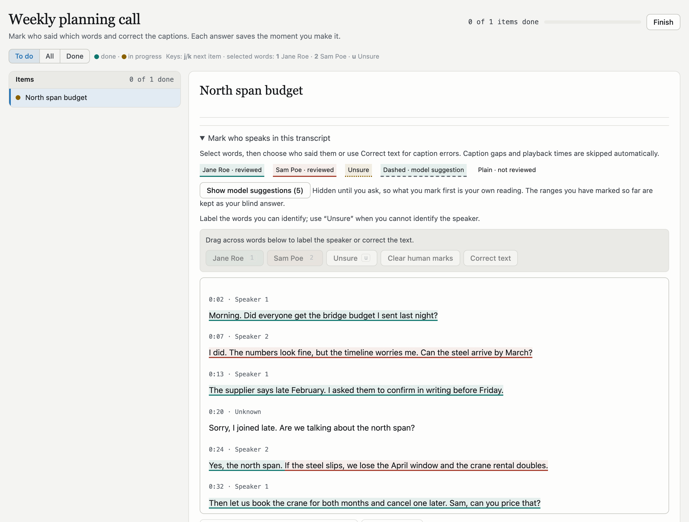

# transcript-labeling

A labeling service that runs on your Mac, for transcripts that a coding agent
needs a person to check. An agent such as Claude Code or Codex gives the service
a transcript, and the service gives you a link. You open the link, mark who said
which words, correct any caption errors and press Finish. The agent then reads
your labels back as JSON.



*The labeling page on an invented call. The underline color shows who said each
phrase. The caption at 0:24 holds two speakers, so it is split between Jane and
Sam. The late joiner's caption at 0:20 is not marked yet.*

## Why it exists

Transcripts often name speakers badly. A transcriber writes "Speaker 1" or
"Unknown", or puts two people into one caption. An agent cannot tell who spoke,
and a guess is not a label. Before this service, each of these questions needed
a one-off web page and a downloaded answers file. Now it takes one command for
the agent and one link for you.

## What you can label

- **Who said which words.** Drag across words, then press a speaker's key or
  click the speaker's name. One caption can hold two speakers. Words that you do
  not mark stay unknown.
- **What was said.** Correct the text of a caption. The original text is kept,
  and a correction never moves a speaker mark.
- **Questions about each transcript.** A dataset can carry a checklist. Each answer
  takes one key press.

Each answer saves the moment you make it.

An agent can also attach suggestions, such as the transcriber's own speaker
labels. By default the page hides them until you mark at least one range and
ask to see them. Your first marks are then your own reading. The service keeps
a record of the marks you made before you saw the suggestions, so results with
and without them can be reported apart.

## How it works

1. The agent runs `tl new` with the transcript file and the list of speakers.
   The service stores the transcript and returns a one-time login link.
2. The agent sends you the link. The link works once, within 7 days.
3. You label in the browser, then press Finish.
4. The agent runs `tl wait` until you finish, or checks later with `tl status`.
5. The agent runs `tl export` and reads the file that it writes.

```sh
tl new demo/planning-call --from-file call.txt --create-project \
  --speakers "jane=Jane Roe:1,sam=Sam Poe:2"
# Send the owner this link (it works once, within 7 days):
# http://127.0.0.1:8790/login#code=...

tl wait demo/planning-call --until done --timeout 3600
tl export demo/planning-call segments
# wrote ~/.local/share/transcript-labeling/exports/demo/planning-call/segments.json
```

`demo/planning-call` names a project and a dataset. A dataset is one labeling
task, and each transcript in it is an item. Each speaker is written as
`id=Label:key`. The id appears in the export, the label appears on the page, and
the key marks the selected words. Run `tl` inside your project's git checkout,
because each write records the repository that made it. Outside a checkout, add
`--repo owner/name`.

The `segments` export has one row per caption. This is the split caption from
the picture above:

```json
{"index": 4, "label": "Speaker 2", "t_start": 24, "t_end": 31, "start": 77, "end": 95,
 "reviewed": true, "speakers": ["jane", "sam"], "split": true,
 "pieces": [{"start": 77, "end": 81, "speaker": "jane", "origin": "human", "text": "Yes, the north span."},
            {"start": 81, "end": 95, "speaker": "sam", "origin": "human",
             "text": "If the steel slips, we lose the April window and the crane rental doubles."}]}
```

`label` is what the transcriber wrote, and `speaker` is what you marked. Times
are in seconds. `start` and `end` are word positions in the transcript,
counted from 0, and `end` is one past the last word. A piece with `"speaker": null` holds words that you left unmarked,
so they are unknown. Other exports give your marked ranges, the result for
each passage an agent asked about, your caption corrections, your checklist
answers and your notes. [docs/API.md](docs/API.md)
lists them.

### Transcript formats

The service detects the format of each file:

- **Zoom-style captions.** Each caption is a `00:00:24 --> 00:00:31` line, then
  a `Label: text` line. The page shows each caption's time and label, and
  `--suggest-map "Speaker 1=jane"` turns those labels into suggestions.
- **Bracketed time marks**, such as `[00:00:05] Welcome back to the show.`
- **Plain text.**

The service refuses WebVTT and SRT files for now. Convert them to one of the
formats above first.

## Claude Code and Codex

Claude Code agents run `tl` in their shell.

Codex agents use `tl mcp`, which offers the same steps as tools over MCP, the
protocol Codex uses to call outside tools. Codex's sandbox stops shell commands
from connecting to the local server, but Codex starts MCP servers outside that
sandbox. Register the server once in `~/.codex/config.toml`:

```toml
[mcp_servers.tl]
command = "/Users/<you>/.local/bin/tl"
args = ["mcp"]
```

Through MCP, an agent can write only to local-only projects. Its `export` tool
returns the file's path and counts, never the transcript text.

## Privacy and safety

- The server listens on 127.0.0.1 only, so one person per Mac can label.
- Agents prove who they are with a token file that only your macOS account can
  read. Your browser logs in with the one-time link. The page sends its session
  in a request header, never in a cookie.
- An agent cannot answer for you. The service refuses answers, notes, done
  marks and requests to show suggestions when they come with the agent's token
  instead of a browser session.
- An agent that runs as your macOS user can still read the token, make a link
  and open it. These checks keep out other accounts and web pages, not your own
  agents.
- A local-only project keeps its transcripts and labels under
  `~/.local/share/transcript-labeling`. `tl export` refuses to write transcript
  text into a git work tree unless you add `--no-text`. A pipe such as
  `| tee file` gets past that check.
- A git-private project keeps its datasets in a private git checkout that you
  name. `tl` refuses the checkout unless every remote is a private GitHub
  repository. The service can commit
  the label files there, but it never pushes.
  [docs/SPEC.md](docs/SPEC.md) says when it commits.

## Install

You need macOS, Python 3.12 or newer, and [uv](https://docs.astral.sh/uv/).

```sh
uv tool install git+https://github.com/tonygwu/transcript-labeling
tl init     # makes ~/.local/share/transcript-labeling, its config and its token
tl serve    # runs the server in this terminal, at http://127.0.0.1:8790
```

Then run `tl doctor` in another terminal to check the setup. To start the server
at login and restart it after a crash, install it as a launchd agent.
[docs/DEPLOY.md](docs/DEPLOY.md) has those steps, and the steps to upgrade and
remove it.

## Status

Version 0.1.0 has run on the author's Mac since 2026-10-25. It is built for one
person's setup and is not published on PyPI. The labeling page and its answers
format come from the annotation tool of
[verbatim-index](https://github.com/tonygwu/verbatim-index).

| Document | What it covers |
|---|---|
| [docs/SPEC.md](docs/SPEC.md) | What the service stores, what it promises, and its known limits |
| [docs/API.md](docs/API.md) | Every HTTP call, `tl` command and MCP tool |
| [docs/DEPLOY.md](docs/DEPLOY.md) | The always-on install, upgrades and removal |
| [docs/HISTORY.md](docs/HISTORY.md) | What was taken from verbatim-index, and from which commit |

## Development

```sh
uv run pytest                                            # the test suite, which needs node
uv run --group browser playwright install chromium       # once
uv run --group browser pytest -m browser                 # drives the real page in Chromium
uv run --group browser python ops/readme_screenshot.py   # redraws the picture above
```

The service, the CLI and the MCP server use only the Python standard library.

## License

MIT
